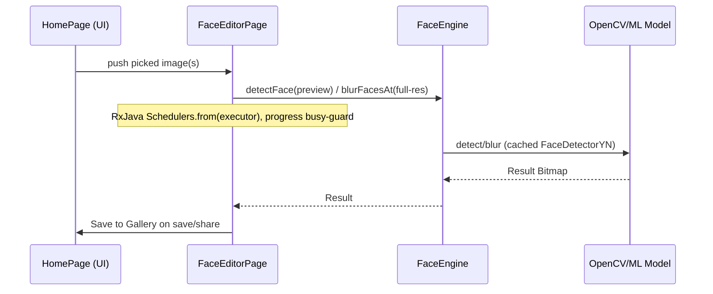
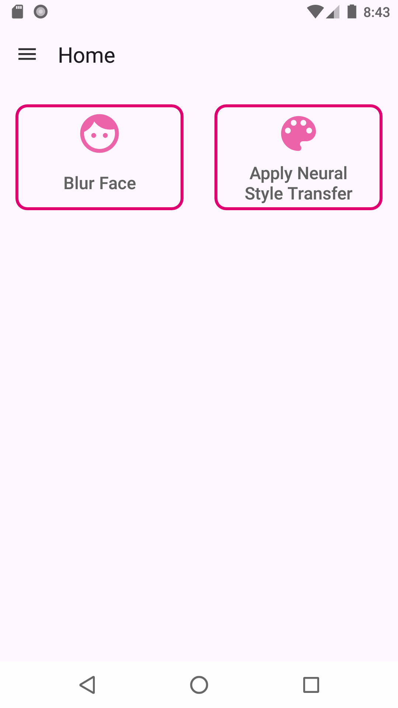
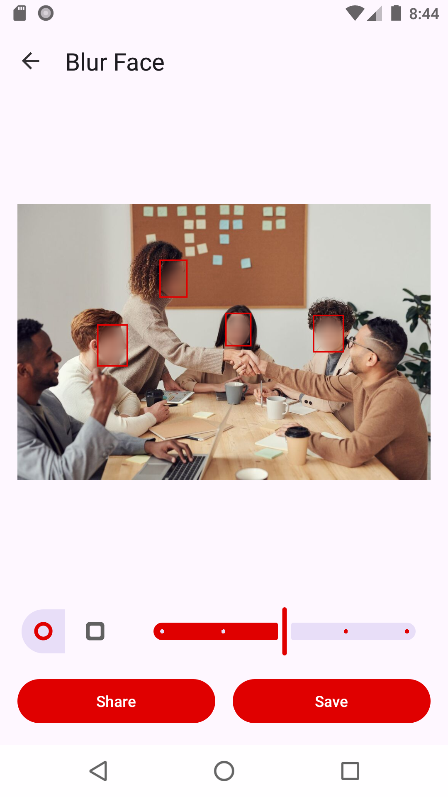

# Jarwis

The power of AI in the palm of my hands!

This is AI utility app for Android device, it basically uses AI model directly on-device to help on performing some tasks.  

## Features
### Face Blur
<ul>
    <li>Detect and add blur effect on people face and export the result to gallery</li>
    <li>Detect and select which face to be blurred and export the result to gallery</li>
</ul>

### Neural Style Transfer
<ul>
    <li>Select neural style transfer theme to apply to the image(s) and export the result to gallery.
        (Themes: Mosaic,Candy,Rain Princess,Udnie,Pointilism)
    </li>
</ul>

### Background Blur & Removal (Portrait Segmentation)
<ul>
    <li>Pick a photo and segment the human inside it with the on-device PP-HumanSeg model
        (downloaded on demand)</li>
    <li>Blur everything except the person for a bokeh/portrait effect</li>
    <li>Cut the person out with a fully transparent background</li>
    <li>Remove mode exports a PNG preserving the alpha channel; blur mode exports the usual JPEG</li>
</ul>

### Magic Eraser (Object Removal)
<ul>
    <li>Pick a photo and paint brush strokes over the object to remove, then press
        Detect object to segment it with the on-device EfficientSAM model
        (downloaded on demand)</li>
    <li>The segmented object is inpainted away with the on-device LaMa model so the
        background fills the hole</li>
    <li>Multiple erases per photo (adjust the strokes and re-detect, undo/reset for
        the current marking), the full resolution result is rebuilt on save/share</li>
</ul>

### QR Code Censor
<ul>
    <li>Pick one or more photos and every detected QR code is outlined — tap a code to toggle
        its censor blur, then export the result to gallery</li>
    <li>Uses OpenCV's <code>QRCodeDetector</code> running in-box, so no AI model download is
        needed</li>
    <li>Reuses the face editor's blur controls: ellipse or square shape with strength 1..5
        (per-image <code>BlurConfig</code>)</li>
</ul>

### QR Scanner
<ul>
    <li>Live camera scanning — frames are decoded in real time on-device using CameraX
        (Preview + ImageAnalysis) with an OpenCV-backed decoder, no AI model download needed</li>
    <li>Results accumulate in a list with per-line copy, "copy all" and tappable URL links,
        and can be shared</li>
    <li>A "scan from image" option decodes a QR code from an existing gallery photo</li>
</ul>

### AI Image Detector
<ul>
    <li>Pick an image and the app estimates how likely it was AI-generated with the
        on-device CommunityForensics DeepfakeDet-ViT model (~87 MB, downloaded on
        demand): the result card shows a confidence band (likely AI-generated /
        unclear / likely camera-original), the AI-generated percentage and a
        disclaimer that the estimate is never evidence</li>
    <li>The detector is deliberately conservative: stylized artwork and heavily
        edited photos can be misjudged in either direction and compressed or
        cropped images reduce reliability, so the result is always framed as a
        probabilistic estimate with the uncertainty stated up front (a known
        stylized-art blind spot was measured in the issue-#12 spike)</li>
    <li>"Check another image" re-picks in place and re-runs the analysis, the
        model is kept for the session and released when the page closes</li>
</ul>

### Settings & Theming
<ul>
    <li>Light / dark / follow-system theme, plus Material You dynamic colors (toggle, on by
        default on Android 12+)</li>
    <li>In-app settings page with a log viewer, open-source licenses list, version info, and
        a donations page</li>
</ul>

### On-Demand AI Model Download
<ul>
    <li>AI models are not bundled with the app; when a feature is used for the first time, the
        required models are downloaded once over the internet from their official Hugging Face
        repositories (<code>ModelDownloadDialog</code> enqueues <code>ModelDownloadWorker</code>,
        which runs <code>ModelDownloader</code>)</li>
    <li>Each model is verified against the sha256 checksum reported by its Hugging Face repository
        before use (downloads are resumable), and the download progress is streamed live to the
        UI via <code>ModelChangeNotifier</code> (RxJava)</li>
    <li>An internet connection is only needed for the initial download; afterwards all features
        work fully offline</li>
</ul>

## Architecture

The project follows a modular, layered architecture designed to separate concerns between the UI, business logic, and heavy ML processing.

### Modules

*   **`:app`**: The entry point. Contains all UI pages (home, the five editors, QR scanner, AI detector), navigation registration, and the feature workflows.
*   **`:ml-engine`**: The core intelligence. Encapsulates the logic engines (`FaceEngine`, `STEngine`, `QREngine`, `PersonSegEngine`, `MagicEraserEngine`, `AiDetectEngine`), the AI model catalog with on-demand model download from Hugging Face, and background workers (`WorkManager`).
*   **`:base`**: Shared infrastructure. Contains DI setup (`a-provider` modules), utilities (`FileHelper`, `ImageHelper`, `MediaHelper`), common UI components, and the navigation route constants.
*   **`:settings`**: In-app settings. Theme selection (light/dark/system, Material You dynamic colors), in-app log viewer, open-source licenses page (auto-generated at build time), and version info.

### Key Libraries

*   **a-navigator**: Handles navigation between pages/activities.
*   **a-provider**: A lightweight Dependency Injection (DI) framework.
*   **StatefulView**: A framework for building state-aware UI components.
*   **RxAndroid (RxJava 3)**: Manages asynchronous events and threading in the UI layer.
*   **WorkManager**: Handles deferrable, guaranteed background work (on-demand AI model download).
*   **OpenCV**: Powers the on-device computer vision — face detection, QR code detection, portrait segmentation, style transfer, object segmentation/inpainting and AI image detection (DNN).
*   **CameraX**: Powers the live QR scanner camera preview and frame analysis.

## Logic Flow & Patterns

Interactive ML runs synchronously inside state-aware **editor pages**; every heavy call runs via RxJava on the shared background executor behind a modal progress dialog, and **WorkManager** is used only for on-demand AI model download.

### High-Level Workflow

1.  **User Interaction**: The user picks image(s) in the UI (`HomePage`) and pushes them to an editor page (e.g., `FaceEditorPage`).
2.  **Interactive Editing**: The page calls the engine (e.g., `FaceEngine`) on a downscaled preview; each heavy call runs via RxJava on the shared background executor with a progress dialog as busy-guard.
3.  **Engine Execution**: The engine delegates to its cached processors (OpenCV DNN) — all heavy native work happens here.
4.  **Result**: The edited image is composited at full resolution and saved to the gallery on save/share.

### Diagram

### Deep Dive: Face Detection Flow

1.  **HomePage**: Pushes the picked image to `FaceEditorPage`.
2.  **FaceEditorPage**: Runs `FaceEngine.detectFace` on a downscaled preview; the user taps faces to toggle their blur, with per-image `BlurConfig` (ellipse/square + strength 1..5).
3.  **FaceEngine**: OpenCV's `FaceDetectorYN` (cached shared instance, input size set per call) finds the faces; `blurFaceCrop`/`blurFacesAt` apply the configured blur.
4.  **Save/Share**: The full-resolution composite runs on the background executor and is saved via `MediaHelper`; on page dispose the cached SFace/YuNet face models are released.

### Deep Dive: Neural Style Transfer (NST) Flow

1.  **HomePage**: Pushes the picked image(s) to `StyleEditorPage`.
2.  **StyleEditorPage**: Interactive editor showing each picked image with a row of style tiles (Mosaic, Candy, Rain Princess, Udnie, Pointilism). Tapping a style renders a live stylized preview of the image; missing style models are prompted for download on demand.
3.  **STEngine**: Applies the selected theme by delegating to the cached per-theme `STProcessor` (OpenCV DNN) on a downscaled preview while editing, and at full resolution on save/share.
4.  **Save/Share**: Saves each stylized image to the gallery via `MediaHelper` or writes a temp JPEG for the Android share sheet.

### Deep Dive: Portrait Segmentation Flow

1.  **HomePage**: Checks `PERSON_SEG` model availability first (`HomeWorkflow` triggers the
    `ModelDownloadDialog` download on first use), then pushes the picked images to `PortraitEditorPage`.
2.  **PortraitEditorPage**: Interactive editor showing each picked image with a Blur/Remove mode
    toggle plus a strength slider (blur mode). Mask inference runs once per image; the result is
    engine-cached so mode/strength changes re-composite without re-running the model.
3.  **PersonSegEngine/PersonSegProcessor**: The PP-HumanSeg ONNX runs through OpenCV DNN
    (192x192 input); a soft person mask is derived from the two output channels, feathered at
    model resolution, then bilinear-upsampled so edges stay clean without haloing.
4.  **Effects**: Blur mode composites a Gaussian-blurred copy of the full image behind the person.
    Remove mode turns the mask into the alpha channel, exporting a **PNG** whose transparency
    survives the round trip.
5.  **Save/Share**: Saves each image to the gallery via `MediaHelper` (PNG in remove mode,
    JPEG in blur mode) or writes a temp file for the Android share sheet with the matching mime.

## Screenshots

## Support this project
Consider donation to support this project
<table>
  <tr>
    <td><a href="https://teer.id/rh-id">https://teer.id/rh-id</a></td>
  </tr>
</table>
